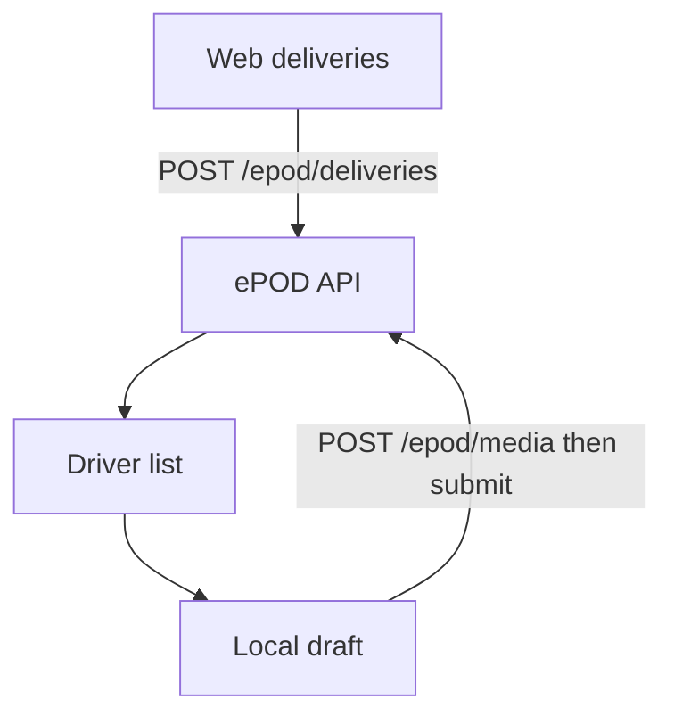

# ePOD frontend handoff

## Implementation status (2026-11-03)

Checked against LORO-S / LORO-W / LORO-A. Markers: ✅ completed · ❌ not / partial · ❓ needs verification.

### Driver gate / routing (from “Mobile — inside the current APK”)

Expected:

- A driver is the existing profile: `workforceType`, `role`, or `accessLevel` equals `driver` (trim + lowercase). Same rule as `server/src/epod/is-driver.ts`. No new access level. Yanga: `workforceType=driver`, `role=user`, `accessLevel=user` → driver.
- Dispatch (web Assign) is `accessLevel` of `admin` | `manager` | `owner` only.
- After sign-in, send a driver to `/home/deliveries` when there is no restored driver route. Do not delete sales / check-in / quotations; hide them from the driver drawer.
- Driver drawer: **Deliveries, Map, Sync, Profile**. Everyone else keeps the current drawer including takeoff.
- `workforceType` comes from `POST /auth/sync-clerk` (`buildStaffProfileData`). It is **not** in the Clerk JWT org role (`payload.o.rol` is `user` for Yanga).

Current gap: drawer `initialRouteName="home"` still mounts the Sales Home stack (`home/index`), pin-unlock restores leftover `/home`, and the home bounce only matches an exact pathname. That is why Yanga still sees Sales Home.

---

## Setup — ✅ Completed

API is deployed; local Nest on 4400 is optional. Web and APK env/docs match this section.

## API the UI must call — ✅ Completed

ePOD controller/service exist on LORO-S. Web and APK call these routes. Not rebuilt.

## One read the assign dialog does not have — ✅ Completed

`GET /epod/assignable-orders` is on `epod.controller.ts` / `epod.service.ts` with specs. Web assign dialog uses it.

## Web — copy takeoff — ✅ Completed

- Pages, hooks, types, proxy, sidebar Truck, SEO, `canDispatchDeliveries`, list/assign/detail: present.
- Tests: `lib/access-deliveries.test.ts` covers dispatch, `/deliveries` access, nav.

## Mobile — inside the current APK — ❌ Not completed / Partially completed

### Routes and module split — ✅ Completed

`app/(tabs)/home/deliveries/` + `modules/deliveries/`. `Stack.Screen name="deliveries"` in home `_layout`. NativeWind / ThemedText / takeoff-style API.

### Driver gate — ❌ Partially completed (landing still wrong)

- ✅ `isDriverProfile` (workforceType / role / accessLevel).
- ❌ Drawer: Deliveries, Sync, Profile only — **Map missing**.
- ❌ After sign-in: still lands on Sales Home (drawer initial route is `home` → `home/index` sales dashboard). Pin-unlock restores stored `/home`.
- ✅ Sales / check-in / quotations not deleted.

### Screens — ❌ Partially completed

- ✅ List (`GET /epod/my-deliveries`), counts, pull to refresh. Empty copy differs slightly from plan.
- ❌ List filters not present.
- ✅ Detail: address, navigate, call, lines, confirm arrival, offline arrival on draft.
- ✅ Goods / document / receiver photo / signature / review / submit / success / PDF / sync.
- ✅ “Step n of 4”, `react-native-signature-canvas`.
- ❌ **Map screen** (today’s pins via travel-route WebView) not built.

### Offline — ✅ Completed

`'epod'` on outbox + `DOMAIN_ORDER`, `epod-offline.ts`, `epod-sync.ts`, barrel import from signed-in runtime.

### Tests — ❌ Partially completed

- ✅ `isDriverProfile` tests (including Yanga-shaped `user` + `driver` workforce).
- ✅ Draft helper tests.
- ❌ Drawer test expects Deliveries / Sync / Profile — plan requires Map too.
- ❓ Device/simulator: driver land on list — **failing (this bug)**. Online complete / mid-wizard resume / airplane sync not fully verified here.

## Out of scope — ✅ Completed (respected)

No client-portal / new access level / chat / OCR / quotation-takeoff changes. No LORO-S changes in this pass besides the already-shipped assignable-orders read.

---

The server in [server/src/epod/](server/src/epod/) is the contract. Do not rebuild it. Web and the current Expo app have no deliveries screens yet. Copy takeoff. Leave the client portal [web/app/orders](web/app/orders) and the sales cart alone.

A driver is the existing profile: `workforceType`, `role`, or `accessLevel` equals `driver` (same rule as [server/src/epod/is-driver.ts](server/src/epod/is-driver.ts)). Do not add a new access level or a phone toggle. Dispatch is `accessLevel` of `admin`, `manager`, or `owner` only.

Share this plan with the other developer and add them to the repo. GitHub cannot limit a collaborator to `web/` and `apk/` only, so the instruction is: change those two apps, plus the one read below if Assign has no order list.

## Setup

The API the web and APK call is already deployed.

- API base: `https://api.loro.co.za`. There is no path prefix on the routes, so a call is `https://api.loro.co.za/epod/...`.
- Swagger: [https://api.loro.co.za/api#/](https://api.loro.co.za/api#/). Open the `ePOD` tag for the request and response shapes.
- Auth is `Authorization: Bearer <Clerk JWT>` from the same Clerk app as web and the APK.
- Web: from [web/](web/), `yarn install`, copy [web/.env.example](web/.env.example) if `.env` is missing. Set `NEXT_PUBLIC_API_URL=https://api.loro.co.za` and the same Clerk keys as that API. `yarn dev` (port 3000). Tests: `yarn test` (Vitest, `**/*.test.ts`, no page renderer).
- APK: from [apk/](apk/), Node `>=22.13.0`, `yarn install`, copy [apk/.env.example](apk/.env.example). Set `EXPO_PUBLIC_API_URL=https://api.loro.co.za`. `yarn start`. Tests: `yarn test` is `jest --watchAll`; for a one-shot run use `yarn test --watchAll=false`.

A local Nest process on port `4400` is only for someone changing `server/`. The frontend work uses the deployed API above.

Give the other person a staff Clerk user (`admin` / `manager` / `owner`) and a second user whose `workforceType` or `role` is `driver`. `GET /epod/drivers` is what the assign dialog uses. That query matches workforce type and role. It does not match a driver who is only `accessLevel === driver`, even though create and the phone check do.

## API the UI must call

No global prefix. Success bodies are the objects below. Errors are `{ success: false, message, statusCode, correlationId }`. Creates and posts return **201**.

- `GET /epod/drivers` — dispatcher only. Bare array `{ uid, name, surname, phone, workforceType, role, accessLevel }`.
- `GET /epod/deliveries?date&driverUid&status` — `{ deliveries: DeliverySummary[] }`. Dispatcher sees the org. A driver only sees their own rows (a passed `driverUid` is ignored).
- `POST /epod/deliveries` — `{ orderUid, driverUid, routeCode, scheduledDate }` with `scheduledDate` as `YYYY-MM-DD`. Returns `DeliveryDetail`. Assignable order statuses: `packing`, `in_fulfillment`, `paid`, `inprogress`, `outfordelivery`. Create sets the order to `outfordelivery`. `409` if that order already has a delivery in `assigned`, `in_progress`, or `recorded`. A cancelled row does not block a new one. Cancel does not move the shop order back.
- `GET /epod/deliveries/:uid` — `DeliveryDetail`. Another driver’s stop is `404`.
- `POST /epod/deliveries/:uid/cancel` — dispatcher, no body, only before `recorded`.
- `GET /epod/my-deliveries?date=` — driver only. `{ date, routeCode, assigned, completed, remaining, deliveries }`. Cancelled rows are omitted here. Send the driver’s local `YYYY-MM-DD`. If `date` is omitted the server uses UTC today.
- `POST /epod/deliveries/:uid/arrive` — `{ lat, lng, arrivedAt? }`. Repeat while `assigned` or `in_progress` is safe.
- `POST /epod/media` — multipart fields `kind` (`goods | document | receiver | signature`) and `file`. JPEG, PNG, WEBP, HEIC, or HEIF, max 8MB. Returns `{ url, kind }`. Do not send proof photos to `/docs/upload`.
- `POST /epod/deliveries/:uid/submit` — `clientSubmissionId` (UUID, 8–80 chars), `packagingCondition`, `exception` (`none | short_quantity | damaged | customer_rejected`), `receiverName`, optional company and position, `items: { uid, deliveredQty }[]` where `uid` is the **delivery line** uid, optional `goodsPhotoUrls`, required `documentUrl`, `receiverPhotoUrl`, `signatureUrl`, optional arrival GPS, required `submitLat` / `submitLng`. Same id on the same stop returns the existing proof and does not move the order again. Short quantity is allowed only for `short_quantity` or `customer_rejected`. `none` and `damaged` need the full ordered qty. `none`, `short_quantity`, and `damaged` set the order to `delivered`. `customer_rejected` sets it to `returned`.
- `GET /epod/deliveries/:uid/pdf` — `{ url }` after `recorded`.

`DeliverySummary`: `uid`, `deliveryNumber` (`DEL-<uid>`), `status`, `routeCode`, `scheduledDate`, `orderUid`, `orderNumber`, `driverUid`, `clientName`, `clientAddress`, `contactName`, `contactPhone`, `latitude`, `longitude`, `itemSummary`, `exception`, `pdfUrl`.

`DeliveryDetail` adds `items[]` (`uid`, `orderItemUid`, `name`, `orderedQty`, `deliveredQty`), `media[]`, `steps` (`arrived`, `goodsChecked`, `documentCaptured`, `receiverPhoto`, `signed`), packaging and receiver fields, arrival and submit GPS and times, `clientSubmissionId`.

## One read the assign dialog does not have

`POST /epod/deliveries` needs `order.uid` from [server/src/shop/entities/order.entity.ts](server/src/shop/entities/order.entity.ts). [web/api/endpoints/shop-quotations.ts](web/api/endpoints/shop-quotations.ts) calls `GET /shop/quotations`, and that list does not join orders, so a quotation uid cannot be sent as `orderUid`.

Add one dispatcher read on the existing ePOD controller, for example `GET /epod/assignable-orders`, returning `{ uid, orderNumber, status, clientName, itemCount }[]` for orders in this org whose status is assignable and that do not already have an open or recorded delivery. Match the Swagger response DTO to that array. Add a service spec next to [server/src/epod/epod.service.spec.ts](server/src/epod/epod.service.spec.ts). Do not change quotation or takeoff.

## Web — copy takeoff

Staff route `/deliveries`. Files to mirror:

- Pages: [web/app/takeoff/page.tsx](web/app/takeoff/page.tsx) (`auth()` then `redirectToSignIn`), [web/app/takeoff/takeoff-list-content.tsx](web/app/takeoff/takeoff-list-content.tsx), [web/app/takeoff/create-takeoff-dialog.tsx](web/app/takeoff/create-takeoff-dialog.tsx), [web/app/takeoff/[uid]/page.tsx](web/app/takeoff/[uid]/page.tsx), [web/app/takeoff/takeoff-detail-content.tsx](web/app/takeoff/takeoff-detail-content.tsx).
- Client: [web/api/endpoints/takeoff.ts](web/api/endpoints/takeoff.ts), [web/api/hooks/use-takeoff.ts](web/api/hooks/use-takeoff.ts), [web/api/types/takeoff.ts](web/api/types/takeoff.ts), and the export block in [web/api/hooks/index.ts](web/api/hooks/index.ts). Axios is already [web/api/client.ts](web/api/client.ts) via `useApiClient()`. It strips `Content-Type` for `FormData`. Query keys like `['epod', 'list', date]`. Invalidate on assign and cancel.
- Protect `"/deliveries(.*)"` in [web/proxy.ts](web/proxy.ts) the same way `"/takeoff(.*)"` is protected.
- Nav: add `{ path: "/deliveries", label: "Deliveries" }` to `STAFF_SIDEBAR_ROUTES` and to `fullNav` inside `getAllowedRoutes`, and add `"/deliveries"` to `STANDARD_USER_PATHS` in [web/lib/access.ts](web/lib/access.ts). Icon in `ROUTE_ICONS` in [web/components/app-sidebar.tsx](web/components/app-sidebar.tsx) (`Truck` from `lucide-react`). `PAGE_COPY.deliveries` in [web/lib/seo/routes.ts](web/lib/seo/routes.ts) and `'/deliveries'` in [web/lib/seo/app-disallow-paths.ts](web/lib/seo/app-disallow-paths.ts).
- Add `canDispatchDeliveries` beside `canManageStaffUsers`. True only for `admin`, `manager`, and `owner`. Use it for the Assign button only. `hr` must not dispatch. Restricted staff can open the page and see only what the API returns for them.

UI, using existing [web/components/ui](web/components/ui) (`dialog`, `table`, `button`, `card`, `input`, `badge`, `calendar` or `date-picker-field`):

- List: day (default today), status filter, driver filter for dispatchers, table of number, client, route, status, item summary. Row opens `/deliveries/[uid]`. Empty and error states like takeoff (`LoadingSpinner`, `getQueryErrorMessage`).
- Assign dialog: order from `GET /epod/assignable-orders`, driver from `GET /epod/drivers`, route code (example `GP-07`), date. Success closes and refreshes the list.
- Detail: read-only status, driver, route, client, lines with ordered vs delivered, exception, arrival and submit GPS, receiver fields, image links, signature, PDF link from `pdfUrl` or `GET .../pdf`. Cancel only when status is `assigned` or `in_progress` and the user can dispatch.

Tests (Vitest, same style as [web/lib/access-staff.test.ts](web/lib/access-staff.test.ts) and [web/api/hooks/use-assets.test.ts](web/api/hooks/use-assets.test.ts)):

- `canDispatchDeliveries` is true for admin, manager, and owner, and false for `hr` and `user`.
- `STANDARD_USER_PATHS` / `canAccess` allows `/deliveries` for a restricted staff user and still keeps client portal users off it.
- A pure helper filters assignable orders and hides Assign when the user cannot dispatch.
- Run `yarn test` from `web/`. Then in the browser: sign in as a dispatcher, assign, open detail, cancel an unrecorded stop; sign in as a non-dispatcher and confirm Assign is hidden.

## Mobile — inside the current APK

No second app. Routes under [apk/app/(tabs)/home/deliveries/](apk/app/(tabs)/home/deliveries/). UI under `apk/modules/deliveries/`, the way takeoff splits routes and [apk/modules/takeoff/](apk/modules/takeoff/).

Register `<Stack.Screen name="deliveries" />` in [apk/app/(tabs)/home/_layout.tsx](apk/app/(tabs)/home/_layout.tsx). Nested stack like [apk/app/(tabs)/home/takeoff/_layout.tsx](apk/app/(tabs)/home/takeoff/_layout.tsx): thin route files, screens in the module, NativeWind `className`, `Text` from [apk/components/ui/themed-text.tsx](apk/components/ui/themed-text.tsx), `TouchableOpacity` for buttons. HTTP like [apk/modules/takeoff/api.ts](apk/modules/takeoff/api.ts): `` `${API_URL}/epod/...` `` plus `getClerkToken`.

Driver gate: read `backendUserData` from `useSessionSync` ([apk/lib/hooks/session-sync-context.tsx](apk/lib/hooks/session-sync-context.tsx)). `workforceType` is already on the staff profile from [server/src/user/user-auth.service.ts](server/src/user/user-auth.service.ts) `buildStaffProfileData`. Add `isDriverProfile` in something like `apk/lib/utils/user-mode.ts` (workforce type, role, or access level, trimmed and lowercased, equals `driver`). In [apk/modules/navigation/drawer-links.ts](apk/modules/navigation/drawer-links.ts), a driver sees Deliveries, Map, Sync, and Profile. Everyone else keeps the current drawer, including takeoff. After sign-in, send a driver to `/home/deliveries` from [apk/app/index.tsx](apk/app/index.tsx) when there is no restored route. Do not delete sales, check-in, or quotations.

Screens, header “Step n of 4” on goods, document, photo, and receiver:

- List: `GET /epod/my-deliveries`, counts, filters, pull to refresh, empty “No deliveries on this route today.”
- Detail: snapshot address, Navigate with `latitude` / `longitude`, call `contactPhone`, lines, Confirm arrival via [apk/lib/helpers/location.ts](apk/lib/helpers/location.ts) and `POST .../arrive`. Offline: store arrival on the draft and send it with submit.
- Goods: steppers, packaging, exception radios, optional goods photos. Block Next until every line has a qty and an exception is chosen. Enforce the same short-qty rule as the server before submit.
- Document and receiver photo: reuse [apk/components/camera/camera-screen.tsx](apk/components/camera/camera-screen.tsx) and `expo-image-picker` the way [apk/modules/journal/create.tsx](apk/modules/journal/create.tsx) does. Resize with `prepareJournalPhoto`. Continue requires that image. No server OCR. Name field starts empty.
- Receiver and signature: name, company, position. There is no signature package today. Add `react-native-signature-canvas` (the app already has `react-native-webview`) and write a PNG file URI. Clear resets the pad. Next requires name and a non-empty stroke.
- Review, then submit. Success: “Delivery recorded”, PDF, back to the list. If queued, say it is on the device and will sync.
- PDF: open `pdfUrl` when online. Offline, show the local summary and “PDF will be available after sync.”
- Sync: read [apk/lib/store/offline-sync-store.ts](apk/lib/store/offline-sync-store.ts) and the epod pending count.
- Map: today’s stops that have snapshot coordinates. Pin opens that delivery. Maps in this app are a WebView ([apk/modules/home/travel-route-map.tsx](apk/modules/home/travel-route-map.tsx)), not `react-native-maps`. No Messages tab.

Offline, same machinery as journal:

- Add `'epod'` to `SyncDomain` in [apk/lib/offline/outbox.ts](apk/lib/offline/outbox.ts) and to `DOMAIN_ORDER` in [apk/lib/offline/sync-engine.ts](apk/lib/offline/sync-engine.ts).
- `apk/lib/offline/epod-offline.ts`: cache-first day list and detail with `cacheFirstRead` ([apk/lib/offline/cache-first.ts](apk/lib/offline/cache-first.ts)). One draft per delivery uid in the entity cache: arrival, qtys, exception, packaging, receiver fields, file URIs. Create `clientSubmissionId` when the driver taps Submit and keep it on the draft.
- Submit through `mutateWithOutbox` with domain `epod`, action `submit`, `idempotencyKey` = `clientSubmissionId`.
- `apk/lib/offline/epod-sync.ts`: `registerSyncHandler`, import it from [apk/lib/offline/index.ts](apk/lib/offline/index.ts) (that barrel is loaded from [apk/lib/providers/signed-in-runtime-effects.tsx](apk/lib/providers/signed-in-runtime-effects.tsx)). Handler uploads each local file with `POST /epod/media`, swaps URIs for `url`, then `POST .../submit`. If the server says that `clientSubmissionId` already exists, mark the outbox row synced. Copy the shape of [apk/lib/offline/journal-sync.ts](apk/lib/offline/journal-sync.ts), not the `/docs/upload` URL.

Tests (Jest, colocated `*.test.ts`, same style as [apk/lib/utils/user-mode.test.ts](apk/lib/utils/user-mode.test.ts)):

- `isDriverProfile`: workforce type `driver`, role `Driver`, access level `driver` are true. A sales or field profile is false.
- Draft helper: missing qty or exception blocks Next. Short qty with `none` is rejected. Full qty with `none` is accepted. Submit payload uses delivery item uids and keeps the same `clientSubmissionId` on retry.
- Drawer helper: driver links are Deliveries, Map, Sync, Profile. A non-driver still gets the current home links.
- Run `yarn test --watchAll=false` from `apk/` for those files. On a device or simulator: driver lands on the list, completes one stop online, kills the app mid-wizard and resumes, then finishes one stop in airplane mode and sees it on Sync until the handler succeeds.

## Out of scope

Client portal orders, a new access level, in-app chat, server OCR, quotation and takeoff behavior, and any change under `server/` besides `GET /epod/assignable-orders` and its spec.
